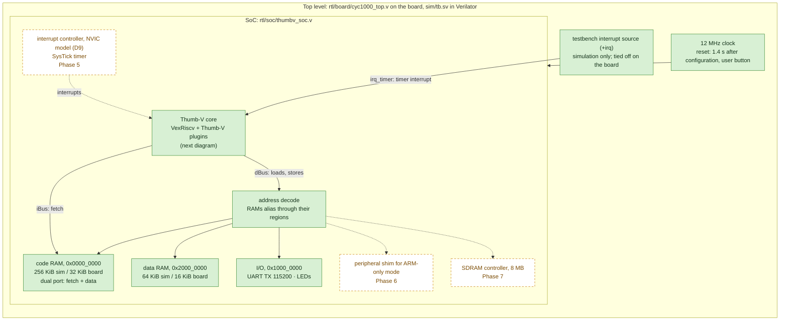
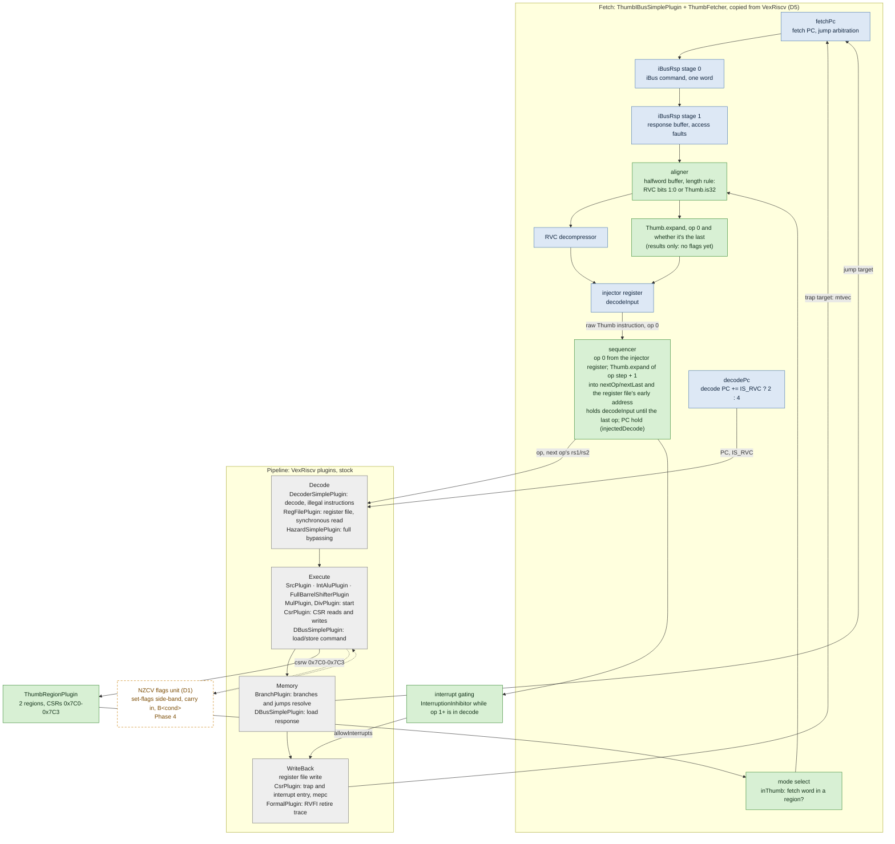

# Architecture

Block diagrams of Thumb-V as built so far, and of what the plan adds. They show where every block comes from:

- **Stock (grey):** VexRiscv as published, used unchanged through its plugin interface.
- **Copied (blue):** VexRiscv code that Thumb-V carries its own copy of (the fetcher, D5), unchanged so far.
- **Thumb-V (green):** written or changed for Thumb-V.
- **Planned (white, dashed):** in the plan, not built yet. The label says which phase.

**Keep this current.** Any change to the RTL's structure updates these diagrams in the same commit: a new block, a block that changes colour (planned → built, copied → changed), or a new connection. The [status table](#status) at the end follows the same rule.

## The system

The SoC is the same in simulation and on the board; only the RAM sizes and the top level differ ([soc.md](soc.md), [board.md](board.md)).

The RVFI retire trace (VexRiscv's `FormalPlugin`) leaves the core only in simulation, where the testbench logs it for the lockstep against the model ([soc.md](soc.md#lockstep-against-the-model)).

## The core

The VexRiscv pipeline with its plugins, in the stage where each one acts. Instructions flow down; jumps and traps go back up to the fetch PC.

**Where the PC comes from.** The decode stage's PC isn't carried down from fetch: `decodePc` keeps its own register, which advances by 2 or 4 (`IS_RVC`) when decode consumes an instruction, and is reloaded on jumps. That is what makes PC-hold cheap for multi-op Thumb instructions ([vexriscv-notes.md](vexriscv-notes.md#where-the-pc-comes-from-pc-hold-for-free)).

**The expander is checked on its own.** `make core` also generates `ThumbExpander.v`, the same `Thumb.expand` function as a module of its own. `tests/test_expander_rtl.py` runs every 16-bit Thumb instruction and a large sweep of 32-bit ones through it in Verilator and compares each op with the model. The core uses the function directly, in the fetcher, so the two can't differ.

**Thumb instructions in the pipeline.** After the aligner, a Thumb instruction is an ordinary RV32 op (or, from Phase 3, a short sequence of them), so the pipeline's stock plugins run it unchanged. What Thumb-V adds downstream of fetch is small: the region CSRs, the flags unit and the interrupt gating, each a separate plugin through VexRiscv's services (D5).

## Status

| Block | Source | State | Since |
|---|---|---|---|
| Pipeline plugins (decode to writeBack) | `third_party/VexRiscv`, stock | built | 1.1 |
| Fetcher: fetch PC, iBus stages, RVC decompressor, injector, `decodePc` | `rtl/core/.../ThumbFetcher.scala`, copied | built, unchanged | 2.1 |
| Mode select, Thumb length rule in the aligner | `ThumbFetcher.scala`, marked `THUMBV` | built | 2.1 |
| Thumb region CSRs | `rtl/core/.../ThumbRegionPlugin.scala` | built | 2.1 |
| Expander, single ops | `rtl/core/.../Thumb.scala` | built: every instruction whose expansion is one op, results only; checked exhaustively against the model | 2.2 (2.1: a stub) |
| Expander, multi-op | `Thumb.scala` | built: every result-only expansion (3.1–3.3), checked op by op against the model | 3.1 |
| Expander alone, for the exhaustive check | `ThumbExpander` in `Thumb.scala`, `sim/expander_tb.sv` | built, simulation only | 2.3 |
| Sequencer, PC hold | `ThumbFetcher.scala`, marked `THUMBV` | built | 3.1 |
| Interrupt gating | `ThumbFetcher.scala`, through `InterruptionInhibitor` | built; tested under interrupts every few cycles (3.4) | 3.1 |
| SoC timer interrupt input, testbench interrupt source | `rtl/soc/thumbv_soc.v` (`irq_timer`), `sim/tb.sv` (`+irq`) | built; the board ties it to 0 | 3.4 |
| NZCV flags unit | plugin | planned | Phase 4 |
| Interrupt controller, SysTick | SoC | planned | Phase 5 |
| Peripheral shim | SoC | planned | Phase 6 |
| SDRAM controller | SoC | planned | Phase 7 |
| SoC: RAMs, address decode, UART, LEDs | `rtl/soc/` | built | 1.2 |
| Board top level | `rtl/board/` | built | 1.4 |
