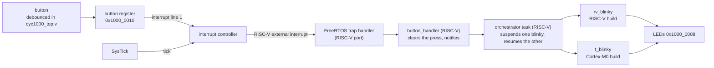

# The board demo: one blinky, two instruction sets

This is the place to start if you're new to Thumb-V. It walks through the demo on the FPGA board, from what you'll see to how it works, how to build and run it, and how it's tested. Links point to the detailed documents for each part.

## What you'll see

A light sweeps back and forth across LEDs 0–6 of a Trenz CYC1000 board. Each press of the board's button switches the code that moves it. Both versions come from one C file, `tests/c/demo_blinky.c`:
- **RISC-V:** built by `riscv64-unknown-elf-gcc`.
- **Thumb:** built by `arm-none-eabi-gcc -mcpu=cortex-m0`, as if for an Arm Cortex-M0.

LED 7 is on while the Cortex-M0 build runs. The sweep doesn't jump at a switch: both builds share its position, so each carries on where the other stopped. The serial port says what happened:

```
Thumb-V demo: press the button to switch between the RISC-V and Thumb builds
running the RISC-V blinky; steps so far: RISC-V 00000000, Thumb 00000000
button: switched to the Thumb (Cortex-M0) blinky; steps so far: RISC-V 0000002c, Thumb 00000000
button: switched to the RISC-V blinky; steps so far: RISC-V 0000002c, Thumb 00000012
```

The step counts are in hex, and each build's count only grows while it runs.

Both builds run on the same processor, at the same time, under one FreeRTOS scheduler. The Arm build is the unchanged output of the Arm compiler. Nothing translates it in software, and there is no Arm core on the FPGA.

## What Thumb-V is

Thumb-V runs ARMv6-M Thumb code, the instruction set of the Cortex-M0, on a RISC-V soft core: [VexRiscv](https://github.com/SpinalHDL/VexRiscv), RV32IM, on the FPGA. A hardware *expander* in the core's front end turns each Thumb instruction into one or more RISC-V instructions, which the core's stock pipeline then executes. Think of it as Rosetta in silicon.

The pieces the demo relies on:

| Piece | What it does | Details |
|---|---|---|
| **Thumb regions** | Two address ranges, set by CSRs `0x7C0`–`0x7C3`. Code fetched from inside them is decoded as Thumb; everything else is RISC-V. A call between the two instruction sets is just a jump. | [core.md](core.md) |
| **The expander** | Turns Thumb instructions into RISC-V ones in fetch and decode, about 1.15 RISC-V instructions per Thumb instruction on CoreMark. | [core.md](core.md), [isa-coverage.md](isa-coverage.md) |
| **Shared registers** | Each Arm register lives in the RISC-V register with the same role in both calling conventions (r0–r3 = a0–a3, r4–r11 = s0–s7, SP = sp, LR = ra). Both sides share one stack and one address space, and most calls need no glue at all. | [interworking.md](interworking.md) |
| **The flags unit** | Arm's condition flags (NZCV), which RISC-V doesn't have, are hardware: set by Thumb compares and arithmetic, read by conditional branches. Also readable as CSR `0x7C4`, so an RTOS can save them. | [flags-decision.md](flags-decision.md) |
| **Interrupt controller** | An ARMv6-M NVIC and SysTick at the addresses Cortex-M code expects (`0xE000_E000`), driving the core's RISC-V interrupt input. | [soc.md](soc.md) |
| **Firmware** | RISC-V code for interrupts and traps from either instruction set, plus the FreeRTOS port glue. | [firmware.md](firmware.md) |

The SoC around the core is small and hand-written: code RAM, data RAM, a UART transmitter, the LEDs, the button and the interrupt controller. The diagrams are in [architecture.md](architecture.md).

## How the demo works



### The program

| File | What |
|---|---|
| `tests/c/demo_main.c` | RISC-V: `main`, the orchestrator task, the button's interrupt handler |
| `tests/c/demo_blinky.c` | The blinky, built twice: `rv_blinky` by the RISC-V compiler and `t_blinky` by the Arm one (`#ifdef __thumb__` picks the name) |
| `tests/c/demo.h` | The interface between the two sides: what each implements and calls (`interworking.md`) |
| `firmware/freertos/` | FreeRTOS on Thumb-V: the configuration, the tick, NZCV in each task's context |
| `third_party/FreeRTOS-Kernel` | FreeRTOS V11.3.3, unmodified, with its RISC-V port |

**The tasks:**
- **The orchestrator** (RISC-V, priority 2) sleeps until the button's interrupt handler sends it a task notification. Then it suspends the running blinky, resumes the other, and prints which one now runs. Presses in the next 150 ms are ignored.
- **The two blinkies** (priority 1) run the same loop: write the LEDs, move the shared position one step, sleep 80 ms with `vTaskDelay`. The Thumb one starts suspended.

**How Arm code calls FreeRTOS.** The kernel is RISC-V code, and `t_blinky` calls `vTaskDelay`, `vTaskSuspendAll` and `xTaskResumeAll` by name. The build (`thumbv.build.mixed_program`) does the linking:
1. It reads `demo.h`, where those functions are marked `THUMBV_RISCV`.
2. It links the Arm build against a jump table at a fixed address in RISC-V code.
3. It links the RISC-V side with the table's entries pointing at the real functions.

The two calling conventions pass these arguments in the same registers, so each call is just a jump. `t_blinky` itself is marked `THUMBV_THUMB`, so the RISC-V side can pass it to `xTaskCreate` like any task function.

**Interrupts and the tick.** FreeRTOS's own RISC-V trap handler is `mtvec`. SysTick, the Cortex-M timer in the interrupt controller, makes the tick. For each interrupt, `firmware/freertos/thumbv_freertos.c`:
1. claims the interrupt from the controller;
2. for SysTick, ticks the kernel; for anything else, calls the handler registered with `thumbv_set_handler`;
3. completes it.

The button's handler clears the press, because the line is level-sensitive, and wakes the orchestrator with `vTaskNotifyGiveFromISR`.

**Context switches and the flags.** A task can be preempted between a compare and its conditional branch, and the branch depends on NZCV. RISC-V code never touches NZCV, but two Thumb tasks would share it. So Thumb-V's FreeRTOS port saves NZCV as part of every task's context, using the port's standard hook for extra registers (`freertos_risc_v_chip_specific_extensions.h`). `test_freertos` shows what goes wrong without it.

**One step at a time.** Each blinky step runs with the scheduler suspended (`vTaskSuspendAll` … `xTaskResumeAll`). Otherwise a press could suspend a blinky between its LED write and its position update, and when it resumed it would write back an out-of-date position. The simulation test found this race.

**The button** has no pull-up on the board, so the FPGA pin's weak pull-up is on. `rtl/board/cyc1000_top.v` synchronises it and debounces it: a new level must hold for 5.5 ms. In the SoC (`rtl/soc/thumbv_soc.v`), a press sets a latch at `0x1000_0010`, which drives interrupt line 1 until software clears it:
- bit 0: the button is held;
- bit 1: pressed since last cleared; write 1 to clear it.

**Size.** The demo uses about 11 KB of RISC-V code (the kernel, the firmware and the program) out of the 16 KiB the board leaves for it. The Thumb blinky is 80 bytes. The RISC-V data, mostly the FreeRTOS heap, is 6.6 KB of the 8 KiB available. The FPGA design uses 7,023 of the 10CL025's 24,624 logic elements (29%) and closes timing at 33 MHz; the board clocks it at 12 MHz ([resources.md](resources.md)).

## What you need

**Hardware:**
- A **Trenz CYC1000** (Intel Cyclone 10 LP `10CL025YU256C8G`) and a micro-USB cable. Its on-board Arrow USB Blaster provides both JTAG, to load the FPGA, and a serial port, for the UART. Nothing else needs connecting.

**Host:** Ubuntu 24.04. Other Linux distributions should work with the equivalent packages; nothing has been tried on macOS or Windows.

**Software** (versions and licenses in [dependencies.md](dependencies.md)):

| Tool | For | Install |
|---|---|---|
| `arm-none-eabi-gcc`, newlib | the Cortex-M0 build | `sudo apt-get install gcc-arm-none-eabi libnewlib-arm-none-eabi` |
| `riscv64-unknown-elf-gcc`, picolibc | the RISC-V build (it targets RV32 too) | `sudo apt-get install gcc-riscv64-unknown-elf picolibc-riscv64-unknown-elf` |
| uv | the Python environment: the model, the build and board scripts, the tests | `curl -LsSf https://astral.sh/uv/install.sh \| sh` |
| Java, sbt | generating the core from its Scala source (SpinalHDL) | sbt's apt repository, see [setup.md](setup.md#phase-1-and-later) |
| Verilator | simulating the SoC; linting | `sudo apt-get install verilator` |
| Quartus Prime Lite, with Cyclone 10 LP support | building the FPGA image | Altera's download centre, see [setup.md](setup.md#the-board) |
| openFPGALoader | loading the FPGA over USB | `sudo apt-get install openfpgaloader` |

For the board, be in the `plugdev` and `dialout` groups, then unplug and replug it after installing openFPGALoader. `make check-tools` reports what's missing.

## Build and run it

```sh
git clone git@github.com:oskarvh/thumb-v.git
cd thumb-v
make setup               # the submodules (VexRiscv, FreeRTOS, ...) and the Python environment
make check-tools         # what's installed
make board PROGRAM=demo  # build, load, and show the UART for 2 s
```

`make board PROGRAM=demo` does all of this, rebuilding only what changed:
1. Generates the core (`make core`: Scala → `build/rtl/VexRiscv.v`).
2. Compiles both sides of the program: the Arm build of the blinky, then the RISC-V side (FreeRTOS, the firmware, `demo_main.c` and the RISC-V blinky) linked against it.
3. Writes the program into the FPGA RAMs' initial contents (`build/board/code.mem`, `data.mem`).
4. Runs Quartus (about 70 s), only when the program or the RTL changed.
5. Loads the FPGA over JTAG.
6. Prints the UART for 2 s.

The board keeps running after that, so press the button and watch the LEDs. To see the serial output as you press, read for longer:

```sh
uv run python -m thumbv.board --program demo --seconds 60
```

Or use any terminal program at 115200 baud, 8N1, on `/dev/serial/by-id/usb-Arrow_Arrow_USB_Blaster_*-if01-port0`, opened after the load. Loading the FPGA resets the board's USB chip, so the port disappears and comes back, which closes a terminal that was already open. You'll miss the banner, but every switch is printed. `thumbv.board` handles this: the SoC waits 1.4 s after loading before it starts, and the script reopens the port within that time. Don't read the port with two programs at once: each byte goes to only one of them.

The FPGA's configuration is volatile: unplugging the board erases the demo, and the factory image in its flash comes back. If the LEDs are dimly lit with one red LED on, the load didn't take; run `make board` again.

**Changing it.** The speed and settle time are `#define`s in `demo_main.c` (`DEMO_STEP`, `DEMO_SETTLE`), and the tick rate is in `firmware/freertos/FreeRTOSConfig.h`. To build without the board, use `thumbv.build.demo_program(out_dir, defines)`. It returns the two ELF files, which `riscv64-unknown-elf-objdump` and `arm-none-eabi-objdump` disassemble.

## Test it

Everything that runs on the board runs in simulation first, in **lockstep**: Verilator simulates the RTL of the whole SoC and logs every instruction the core retires. A Python model of Thumb-V then replays the same program and compares every register write, memory access and flag after every instruction. Interrupts and context switches are included: the model takes each interrupt where the RTL took it.

```sh
uv run pytest tests/test_rtl.py -k board_demo -v
```

`test_board_demo` builds the demo with a faster tick, and the testbench presses the button every 60,000 cycles (`+button`). It runs with the board's RAM sizes, and checks:
- four presses give four switches, alternating between the builds;
- each build makes steps only while it runs;
- the model agrees with the RTL on every instruction;
- LED 7 is on for exactly the LED writes made by Thumb code;
- the sweep moves one LED at a time across every switch.

It takes a few seconds once the simulator is built. The first run generates the core and compiles the testbench (a minute or two).

The rest of the tests:

| Command | What | Time |
|---|---|---|
| `make test` | The model and build tests: every Thumb encoding against Unicorn (an Arm emulator), directed and random programs, interworking, and the RTL tests if Verilator and sbt are there | about 2 min |
| `make test-rtl` | The RTL tests, failing instead of skipping when a tool is missing. They include: the exhaustive expander check against the model; the interrupt controller against its model; gcc-compiled programs, CoreMark, Embench, CMSIS-DSP and FreeRTOS on the SoC, in lockstep | about 2 min |
| `make test-slow` | Also CoreMark and Embench in the model, and more random programs | about 10 min |

GitHub Actions runs `make test` and `make test-rtl` on every push (`.github/workflows/ci.yml`). The board itself isn't tested automatically: run `make board PROGRAM=demo` and press the button.

## Where to go next

- **[README.md](../README.md):** the project's goals and design in one page.
- **[architecture.md](architecture.md):** block diagrams of the SoC and the core, and what's built.
- **[plan.md](plan.md):** the design decisions (D1–D9) and the phases, with what each one found.
- **[core.md](core.md), [vexriscv-notes.md](vexriscv-notes.md):** the core's configuration and how the expander fits into VexRiscv.
- **[interworking.md](interworking.md):** calls between RISC-V and Thumb code, the interface headers and the generated thunks.
- **[firmware.md](firmware.md):** the trap entry routine, the interrupt API and FreeRTOS.
- **[soc.md](soc.md), [board.md](board.md):** the memory map, the testbench, the board's pins and memories.
- **[setup.md](setup.md):** installing everything, and running, selecting and adding tests.

Other programs on the board (`make board PROGRAM=...`, [board.md](board.md)):
- `tick`: a Cortex-M0 SysTick handler;
- `dsp`: Arm's CMSIS-DSP library, built for Cortex-M0 and called from RISC-V;
- `rtos`: FreeRTOS with two Thumb worker tasks.
